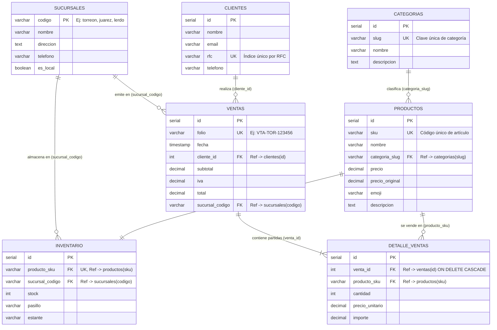
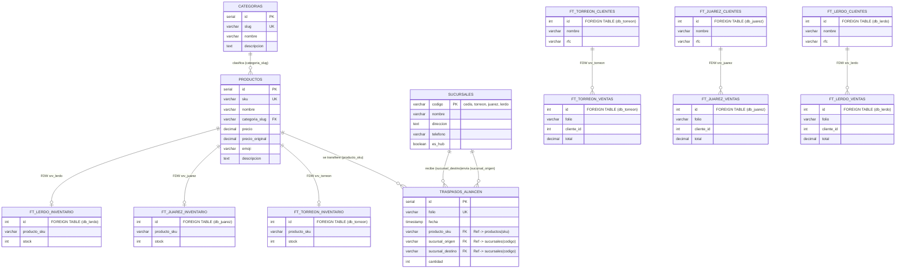

## 📐 1. Diagrama Entidad-Relación: Base de Datos de Sucursal (`estiren_torreon`, `estiren_juarez`, `estiren_lerdo`)

Cada una de las 3 sucursales posee este esquema relacional completo (además de sus tablas foráneas `ft_*_inventario` hacia las otras dos sucursales):

---

## 🌐 3. Diagrama Entidad-Relación y Federación: Base de Datos CEDIS (`estiren_cedis`)

El nodo central del **CEDIS Gómez Palacio (`Puerto 5433`)** mantiene el catálogo maestro, la bitácora de traspasos entre tiendas y las tablas foráneas (`FOREIGN TABLE`) que conectan en vivo con las 3 sucursales:

